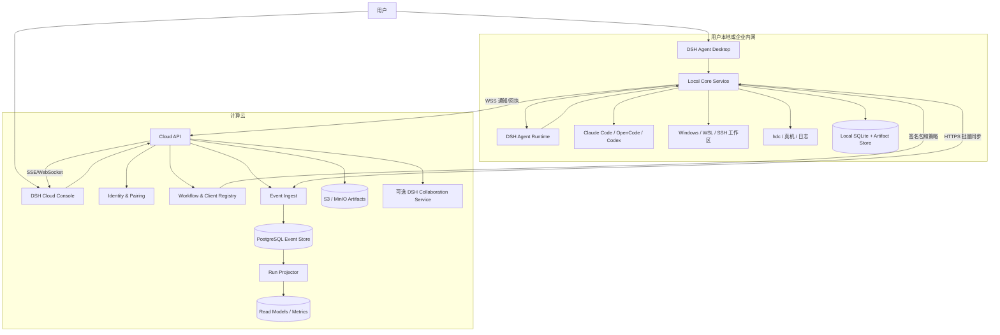
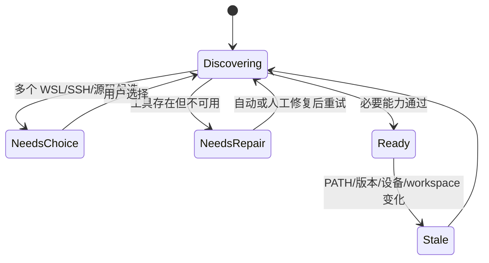
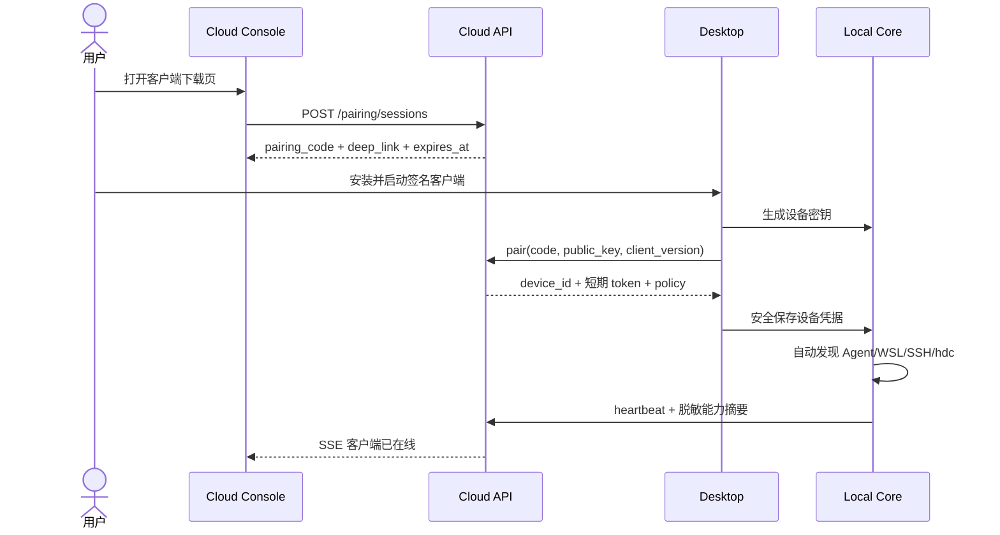
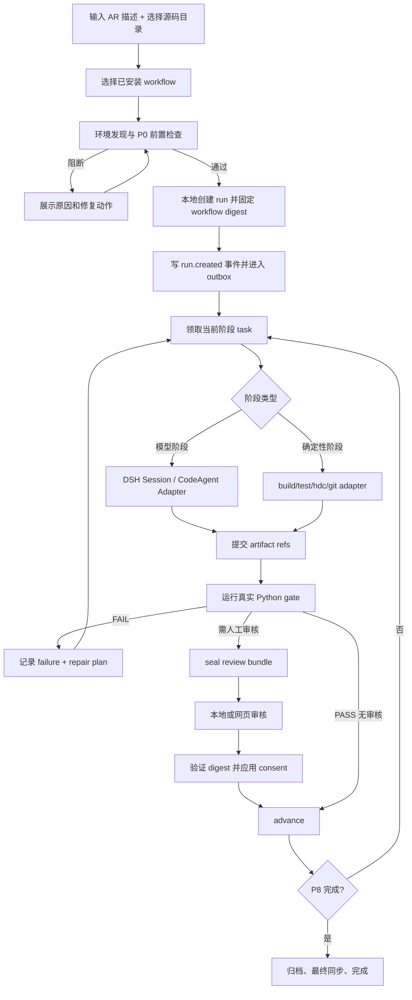
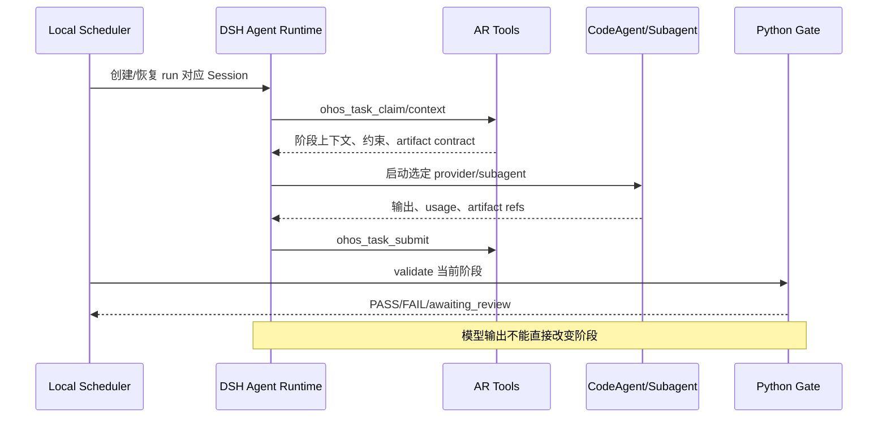
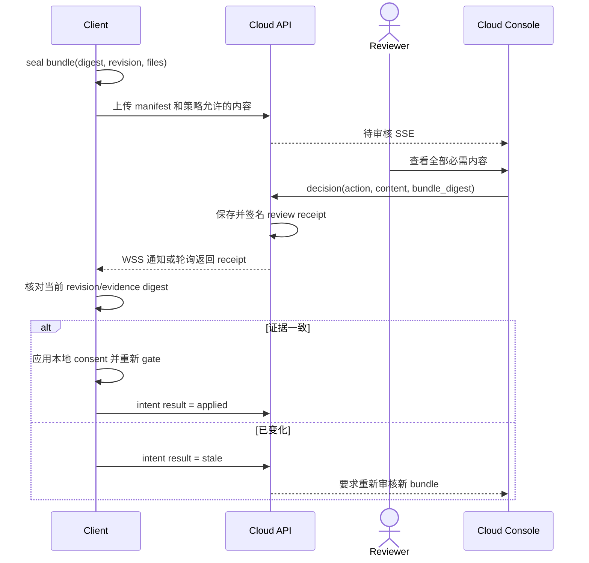
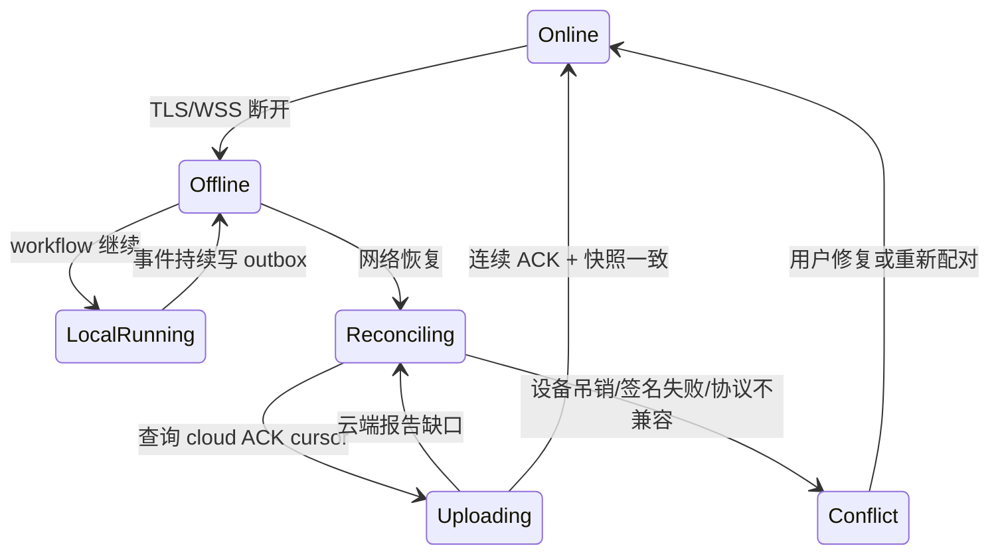

# DSH Agent 客户端与云端网页分离详细设计

版本：1.0（实施基线）<br>
日期：2026-09-21<br>
状态：已批准的实施基线；客户端/云端主要软件链路已达到功能闭环阶段，生产部署与目标设备验收仍有阻塞项<br>
审计基线：`597d703`

### 当前实施状态

独立工程 `dsh-client-platform/` 已实现 Desktop、受限 preload 与本机 Local Core，并把旧 DSH Web 入口归档到 `pending-delete/legacy-dsh-web/`。客户端可选择本机、WSL 或 SSH workspace，调用本机 CodeAgent；Agent 请求经官方 DSH SDK session/adapter 执行，不回退到 DSH 主模型。AR runtime 已贯通 P0 环境检查和 P1–P8 阶段，继续以确定性 gate、构建、测试和设备证据作为阶段通过依据。

Cloud API/Console 已具备设备配对与撤销、设备签名事件接收、离线 outbox 续传、运行/阶段维测投影，以及环境和设备探测遥测展示。用户可选择审核产物上传为 review bundle；云端审核决定支持批准、退回和拒绝，并通过绑定设备、run revision、产物摘要和 nonce 的签名指令回传客户端。客户端持久化审核回执，支持安全重试；退回会重新排入原阶段并继续经过本地 gate，拒绝会终止运行。

目前已达到主要客户端/云端软件功能链路闭环，但这不代表生产就绪或真实目标环境验收完成。生产 OIDC/会话/CSRF adapter、共享数据库与对象存储、多实例限流、密钥管理和备份恢复仍需实现并验收；Windows 安装包仍未代码签名，也未完成正式自动更新与发行；还需在目标 Windows、实际 WSL/SSH 源码环境及真实 OpenHarmony/HarmonyOS 构建和 HDC 设备上完成端到端验收。在上述阻塞项解除前，不应将当前版本作为公网生产服务。当前自动化测试命令及本轮结果见[客户端与云端当前实施说明](./client-cloud-separated-implementation.md)，此处不固定历史测试计数。

## 1. 评审结论摘要

本方案将现有“DSH 官方 Web + 本机 Connector”调整为四个边界清晰的产品单元：

1. **DSH Agent Desktop（客户端）**：用户工作的主入口，也是唯一默认执行平面；
2. **DSH Cloud API（云端控制与数据服务）**：负责身份、配对、workflow 分发、事件摄取、投影和产物；
3. **DSH Cloud Console（独立网页端）**：负责团队运行查看、审核、维测、客户端和 workflow 管理；
4. **DSH Agent Runtime（可插拔内核）**：在客户端负责 Agent Session、Tool、Subagent 和 Provider，不承担产品网页、确定性 gate 和云端数据仓库。

权威边界如下：

- P0–P8 的状态、gate、签名证据、consent、代码和设备操作以客户端本地 runtime 为准；
- 云端保存客户端签名事件的不可变副本并生成查询投影，不反向改写历史事实；
- workflow 包、客户端版本、组织策略和用户身份以云端为准；
- DSH Session 是 Agent 执行记录，不是阶段 PASS 的事实源；
- 云端网页不能直接执行本机 shell、SSH、hdc 或 CodeAgent 命令。

## 2. 目标和非目标

### 2.1 目标

- 新用户从下载客户端到开始 P0 不需要命令行、Node.js、仓库克隆、JSON 或手输长期 token；
- CodeAgent、源码、SSH、WSL、hdc、设备和构建工具均留在用户环境；
- 断网时客户端可继续完整执行，重连后云端数据正确补齐；
- 云端可以展示多个用户、多个客户端和多个 workflow 的状态、统计、审核与产物；
- workflow 可独立下载、固定版本、校验签名和灰度升级；
- DSH 真正进入 Agent 执行链，同时不削弱现有确定性门控；
- 当前 AR workflow P0–P8 能平滑迁移，后续可以注册更多 workflow。

### 2.2 非目标

- 网页静默安装客户端；Windows 必须至少出现一次系统安装确认；
- 云端直接挂载或复制用户完整源码；
- 云端向客户端发送任意命令行；
- 用模型回答替代真实编译、测试、设备或发布 gate；
- 第一期建立通用远程桌面、云 IDE 或源码浏览器；
- 第一期重写现有 Python gate 和 `runtime/dsh-ohos` 状态机。

## 3. 系统上下文



公网只要求客户端出站访问云端 443。客户端不监听公网端口；本地 UI 和 Local Core 只通过操作系统 IPC 或 loopback 随机端口通信。

## 4. 各端职责

### 4.1 职责矩阵

| 能力 | 客户端 | Cloud API | 网页端 | DSH Runtime |
|---|---|---|---|---|
| 安装与升级 | 安装包、自更新、回滚 | 发布版本和签名 manifest | 展示下载和版本 | 不负责 |
| 用户/设备配对 | 生成设备密钥并完成配对 | 一次性配对码、设备证书、吊销 | 发起配对、查看设备 | 不负责 |
| 环境发现 | WSL/SSH/CodeAgent/hdc/源码 | 保存脱敏能力快照 | 展示和筛选 | 可探测 provider |
| Workflow 目录 | 下载、验签、固定版本 | 发布、签名、灰度、撤销 | 选择和管理 | 注册 workflow tools |
| P0–P8 执行 | 权威执行、恢复、gate | 只接收事实和投影 | 展示进度 | 驱动模型阶段 |
| 代码修改 | 本地 CodeAgent | 禁止 | 禁止 | 调度 provider/subagent |
| 编译/测试/设备 | 本地或用户 SSH 主机 | 禁止 | 查看证据 | 通过受限 tools 请求 |
| 人工审核 | 本地可审核和应用 consent | 保存审核包与签名回执 | 完整查看并做决定 | 可触发 approval UI，但不判 PASS |
| 产物 | 本地完整保存、选择上传 | 元数据和对象存储 | 预览/下载/比对 | 可挂 Session attachment |
| 维测 | 采集原始事件和 usage | 去重、投影、聚合 | 图表、导出 | 提供 Session/provider usage |
| AI 问题分析 | 使用本地选定 CodeAgent | 可选协作服务 | 发起云端只读分析 | 管理 Session/Tool/Subagent |
| RAG | 本地索引为默认 | 可选授权云索引 | 状态与配置 | 作为 Agent 检索工具 |

### 4.2 客户端必须完成的事情

- 发现并配置 CodeAgent；
- 发现 WSL 发行版和 Windows OpenSSH Host；
- 选择本地、WSL 或 SSH 源码根；
- 检测 OpenHarmony、HarmonyOS system、HarmonyOS chip；
- 检测 Python、Git、构建入口、测试入口、hdc、设备和发布工具；
- 下载 workflow bundle 并校验签名、hash、最低客户端版本；
- 创建 run、执行 P0–P8、保存事件、gate 证据、人工输入和产物；
- 管理 CodeAgent 进程、编译进程、设备操作、取消和重启恢复；
- 对同步数据脱敏、签名、落 outbox，并处理云端 ACK；
- 在云端不可用时继续运行并明确显示“等待同步”。

### 4.3 云端必须完成的事情

- 身份、租户、角色、设备注册和吊销；
- workflow/client 版本发布、签名和兼容矩阵；
- 接收客户端事件、验证设备签名、幂等去重；
- 生成 run、stage、failure、usage、human action、artifact 等投影；
- 保存网页审核决定并生成绑定 review bundle digest 的回执；
- 提供浏览器查询、筛选、导出和实时更新；
- 保存允许上传的产物，执行 hash、大小、MIME 和恶意内容检查；
- 提供审计日志、备份、保留期和删除流程。

### 4.4 网页端不再做的事情

- 不检测浏览器所在电脑的 PATH、hdc、WSL 或 CodeAgent；
- 不再下载并拼接 PowerShell Connector 启动脚本；
- 不保存 SSH 私钥、CodeAgent token 或本机绝对路径；
- 不直接调用 `agent.start`、`workspace.write`、`hdc shell`；
- 不依据浏览器连接是否存在决定本地任务是否继续。

## 5. 客户端详细结构

### 5.1 进程结构

Windows 第一版采用 Electron，打包固定 Node 24 runtime。客户端由四个进程边界组成：

```text
DSH Agent Desktop.exe
├─ Electron Main
│  ├─ 窗口、托盘、deep link、自动更新
│  ├─ OS Credential / DPAPI
│  └─ 启动和监督 Local Core
├─ Renderer
│  └─ 本地 UI；无 NodeIntegration，只通过类型化 IPC
├─ Local Core Service
│  ├─ workflow runtime / scheduler
│  ├─ environment / workspace / device adapters
│  ├─ local API / SQLite / outbox
│  └─ process supervisor
└─ DSH Agent Runtime Sidecar（按需）
   ├─ Session / Agent / Tool
   ├─ Subagent providers
   └─ usage / context / compaction
```

Renderer 不直接执行文件系统或子进程操作。所有高权限操作必须经过 Main/Core 的 schema 校验，并写本地审计事件。

### 5.2 客户端模块

建议目录：

```text
platform/
  apps/
    desktop/
      main/                    Electron main、托盘、更新、deep link
      renderer/                React UI
      resources/               图标、安装资源、固定 runtime manifest
    local-core/
      src/server/              IPC/loopback API
      src/bootstrap/           首次启动和迁移
  packages/
    contracts/                 云/客户端/DSH 共用 schema
    client-runtime/            ArRuntimeService、Scheduler、Run Store
    environment-discovery/     WSL/SSH/OHOS/HMOS/工具探测
    workflow-manager/          下载、签名、版本固定、回滚
    agent-adapters/            DSH/Claude/OpenCode/Codex/custom
    workspace-adapters/        Windows/WSL/SSH/remote-tools
    device-adapters/           hdc、relay、设备信息
    sync-client/               outbox、ACK、重放、快照
    artifact-client/           manifest、上传、下载、缓存
    local-security/            设备密钥、凭据、路径策略
```

### 5.3 客户端本地数据目录

默认目录：

```text
%LOCALAPPDATA%/DSHAgent/
  config/
    client.json                非敏感设置
    workspaces.json            workspace 别名和类型，不含密钥
  data/
    runtime.sqlite3            run/task/attempt/event/consent
    sync.sqlite3               outbox/inbox/ack/cursor
    workflows/                 已验签 workflow 版本
    artifacts/                 本地完整产物
    rag/                       本地索引
  logs/
    desktop.log
    core.log
    updater.log
  runtime/
    node.exe
    dsh/                       固定版本 DSH runtime
```

设备私钥、refresh token、代理凭据只进入 Windows Credential Manager 或 DPAPI 密文，不写 `client.json`。

### 5.4 客户端 UI 信息架构

| 页面 | 主要内容 | 用户动作 |
|---|---|---|
| 首页 | 云端连接、环境健康、最近 run、待审核、待恢复 | 新建任务、继续任务、修复环境 |
| 环境中心 | CodeAgent、WSL、SSH、源码、hdc、设备、工具链 | 自动检测、测试、选择、修复 |
| Workflow | 已安装/可更新 workflow、版本和兼容性 | 下载、更新、回滚、查看说明 |
| 新建任务 | AR 描述、源码目录、workflow；高级项默认折叠 | 预检、开始 |
| Run 详情 | P0–P8、日志、Agent、失败、人工输入、产物 | 取消、恢复、补充、审核 |
| 审核中心 | 本地待审核和云端回执 | 查看全文、同意、拒绝、退回 |
| AI 对话 | 绑定当前 run/stage/错误和产物 | 分析、追问、生成修复建议 |
| 同步中心 | outbox、最后 ACK、冲突和重试 | 重试、暂停、导出诊断 |
| 设置 | 云地址、数据策略、更新通道、开机启动 | 配对、解绑、清除本地数据 |

### 5.5 环境检测状态机



每个检查必须返回 `status`、`source`、`observed`、`required_for`、`repair_actions` 和 `checked_at`。修复动作分为：客户端可自动完成、需要用户确认、只能给出说明三类。

## 6. 云端结构

### 6.1 云端服务

```text
platform/
  apps/
    cloud-web/                 React/Vite 管理与观测门户
    cloud-api/                 REST、WSS、SSE、OIDC、RBAC
    event-ingest/              签名验证、去重、append-only 写入
    projector/                 run/stage/metrics/read-model 投影
    artifact-service/          S3 multipart、扫描、预览和授权下载
    release-service/           client/workflow 发布和签名
    dsh-collaboration/         可选云端 DSH 只读协作分析
  packages/
    contracts/
    cloud-auth/
    event-model/
    projection-model/
    workflow-registry/
```

MVP 可以将 `cloud-api`、`event-ingest` 和 `projector` 部署为一个进程内的三个模块，但数据库表和接口必须按服务边界设计，避免以后拆分时改变客户端协议。

### 6.2 推荐基础设施

| 层 | 第一期 | 扩展条件 |
|---|---|---|
| API | Node 24 + Fastify | 可横向扩展 |
| 主数据库 | PostgreSQL 16 | run_events 按月/tenant 分区 |
| 对象存储 | S3 或 MinIO | 生命周期和 WORM 策略 |
| 浏览器实时 | SSE | 需要双向协作时增加 WebSocket |
| 客户端通知 | WSS + HTTPS polling fallback | 不用于传任意命令 |
| 后台任务 | PostgreSQL queue/`SKIP LOCKED` | 高吞吐后换 NATS/Kafka |
| 身份 | 企业 OIDC | 开发环境可 loopback disabled |
| 指标 | PostgreSQL 聚合表 | 大规模后引入 ClickHouse |

生产环境如果展示不同用户或团队的数据，必须有身份和租户隔离。`AUTH_MODE=disabled` 只允许 loopback 或明确隔离的单用户开发部署，不能用于公网多人环境。

### 6.3 网页端信息架构

| 一级页面 | 二级内容 |
|---|---|
| 总览 | 在线客户端、运行中/阻塞/成功、成功率、Token、人工等待、常见失败 |
| 客户端 | 用户、设备、版本、最后心跳、能力、workspace、更新状态、吊销 |
| Workflow | 目录、版本、签名、兼容客户端、灰度、撤销、使用次数 |
| 运行 | Run 列表、阶段时间线、当前 blocker、Agent、环境、同步新鲜度 |
| 审核 | 待审核队列、bundle 全文、diff、报告、历史决定、stale 提示 |
| 产物 | manifest、来源、hash、大小、预览、下载、版本比对 |
| 维测 | 阶段耗时、人工介入、Token、重试、失败分类、成功率、客户端健康 |
| AI 协作 | 基于已上传数据的 DSH Session；默认只读 |
| 管理 | 用户/角色、数据策略、保留期、发布密钥、审计日志 |

网页上的所有状态必须展示 `observed_at`、`received_at` 和 `sync_state`。客户端离线时显示最后已知状态，不能把旧数据显示成实时。

## 7. 数据权威与一致性

### 7.1 权威矩阵

| 数据 | 权威端 | 云端行为 |
|---|---|---|
| Run/Stage 当前执行状态 | 客户端 runtime | 验签后投影，不自行推进 |
| gate PASS/FAIL | 客户端 Python authority | 保存证据摘要和可选产物 |
| consent applied | 客户端 | 保存云端审核回执与客户端应用结果 |
| Workflow 版本和签名 | 云端 registry | 客户端下载并固定 digest |
| Client 发布版本 | 云端 release service | 客户端验签更新 |
| CodeAgent/设备可用性 | 客户端探测 | 仅保存脱敏快照 |
| Token 原始 usage | Agent/provider 回执 | 去重聚合，不估算未知值 |
| 用户/租户/角色 | 云端 identity | 客户端缓存最小授权信息 |
| 本地源码与凭据 | 客户端 | 不上传 |

### 7.2 事件事实模型

客户端事件最小结构：

```json
{
  "schema_version": 1,
  "event_id": "01J...ULID",
  "tenant_id": "tenant-1",
  "device_id": "device-1",
  "workspace_id": "workspace-1",
  "run_id": "run-1",
  "client_seq": 1042,
  "run_revision": 18,
  "type": "stage.gate_completed",
  "occurred_at": "2026-09-21T08:00:00.000Z",
  "payload": {
    "phase": "P4",
    "status": "failed",
    "failure_class": "compile_error",
    "evidence_refs": ["artifact:sha256:..."]
  },
  "previous_event_hash": "sha256:...",
  "event_hash": "sha256:...",
  "device_signature": {
    "key_id": "device-key-1",
    "algorithm": "ed25519",
    "value": "base64url..."
  }
}
```

`event_id` 全局幂等，`client_seq` 在设备内单调递增，`run_revision` 在 run 内不能回退。云端只接受已登记设备签名；重复事件返回原 ACK，不重复计量。

### 7.3 快照

事件是事实源，快照只用于加速恢复。客户端定期上传：

- `snapshot_revision`；
- `last_event_id/client_seq`；
- run、stage、open human wait、active attempt 摘要；
- snapshot 内容 hash 和设备签名。

云端发现事件缺口时返回 `expected_client_seq`，客户端补传缺失事件；不能用新快照静默覆盖缺口。

## 8. 客户端与云端交互

### 8.1 传输原则

- 所有业务请求走 TLS 1.2+；
- 客户端只发起出站连接；
- REST 负责配对、目录、批量事件、快照和产物；
- WSS 只传轻量通知和固定类型 intent；断开时由轮询兜底；
- 每个写请求带 `Idempotency-Key`；
- 所有列表分页，所有事件有 cursor；
- 协议按 `/v1` 版本化，未知字段和未知 intent fail closed。

### 8.2 API 分组

#### 身份与配对

| 方法 | API | 作用 |
|---|---|---|
| POST | `/v1/pairing/sessions` | 网页生成一次性配对会话和 deep link |
| POST | `/v1/devices/pair` | 客户端提交配对码、公钥、版本和能力摘要 |
| POST | `/v1/devices/token` | 用设备私钥证明换短期 access token |
| POST | `/v1/devices/{id}/revoke` | 用户/管理员吊销设备 |
| POST | `/v1/devices/{id}/heartbeat` | 在线、版本、能力摘要、同步 cursor |

配对码有效期建议 5 分钟且只能使用一次。配对成功后使用设备密钥和短期 token，不保存长期共享 Connector token。

#### Workflow 和客户端发布

| 方法 | API | 作用 |
|---|---|---|
| GET | `/v1/workflows/catalog` | 获取当前租户可用 workflow 和版本 |
| GET | `/v1/workflows/{id}/versions/{version}` | 获取 manifest、digest、签名和下载地址 |
| GET | `/v1/client/releases/latest` | 检查客户端更新、兼容性和强制升级策略 |
| POST | `/v1/client/releases/{id}/report` | 上报下载/安装/回滚结果 |

Workflow manifest 必须包含：`workflow_id`、语义版本、bundle SHA-256、签名、最低/最高客户端协议、支持环境、阶段 DAG、gate 入口、所需能力、数据策略和发布日期。活动 run 永远固定启动时 digest。

#### Run、事件和指标

| 方法 | API | 作用 |
|---|---|---|
| POST | `/v1/runs/register` | 第一次同步本地创建的 run 摘要 |
| POST | `/v1/runs/{id}/events:batch` | 批量上传有序签名事件 |
| PUT | `/v1/runs/{id}/snapshot` | 上传签名快照 |
| GET | `/v1/runs/{id}/sync-state` | 查询云端 ACK cursor 和缺口 |
| GET | `/v1/runs` | 网页查询投影后的 run |
| GET | `/v1/runs/{id}` | 网页查询详情和数据新鲜度 |
| GET | `/v1/runs/{id}/events` | 分页查询事件时间线 |

事件批次响应：

```json
{
  "accepted_through_client_seq": 1042,
  "duplicate_event_ids": ["01J..."],
  "expected_next_client_seq": 1043,
  "projection_revision": 18,
  "server_time": "2026-09-21T08:00:02.000Z"
}
```

#### 审核

| 方法 | API | 作用 |
|---|---|---|
| POST | `/v1/runs/{id}/review-bundles` | 上传 sealed bundle manifest 和允许的内容 |
| GET | `/v1/reviews/pending` | 网页待审核列表 |
| GET | `/v1/review-bundles/{id}` | 全文、产物和 digest |
| POST | `/v1/review-bundles/{id}/decisions` | 同意、拒绝、退回、请求补充 |
| GET | `/v1/devices/{id}/intents` | 客户端轮询待应用回执 |
| POST | `/v1/intents/{id}/result` | 客户端报告 applied/stale/rejected |

云端审核决定必须绑定 `run_id`、`phase`、`run_revision`、`bundle_digest`、审核人、正文、时间和 nonce。客户端只有在本地当前证据仍与 digest 一致时才能转换为原有 evidence-bound consent；不一致返回 `stale_review`。

#### 产物

| 方法 | API | 作用 |
|---|---|---|
| POST | `/v1/artifacts/manifests` | 登记元数据、hash、来源和数据等级 |
| POST | `/v1/artifacts/{id}/uploads` | 创建 multipart 上传 |
| PUT | 预签名分片 URL | 客户端直传对象存储 |
| POST | `/v1/artifacts/{id}/complete` | 校验分片、总 hash 和长度 |
| GET | `/v1/artifacts/{id}` | 网页读取授权元数据/预览 |
| POST | `/v1/artifacts/{id}/download-url` | 生成短期授权下载 URL |

#### 客户端通知 WSS

允许的服务端 intent 仅包括：

- `review.decision.available`；
- `workflow.update.available`；
- `client.update.available`；
- `policy.updated`；
- `device.revoked`；
- 可选 `run.requested`，默认关闭且必须由客户端用户确认。

intent 中不能出现命令、argv、脚本、SSH 地址或文件写入内容。

### 8.3 同步哪些数据

#### 默认上传

- tenant/device/workspace 的不可逆标识和显示别名；
- 客户端、workflow、Agent adapter 和模型的版本标识；
- run/stage 状态、时间、重试、阻塞和失败分类；
- Token usage 结构化数值及数据完整性；
- 人工动作类型、时间、actor 标识；
- 产物 manifest、hash、大小、类型和来源；
- 脱敏的环境能力和健康状态。

#### 按策略上传

- 人工输入全文；
- prompt 和 CodeAgent stdout/stderr；
- diff、设计文档、测试报告、设备日志；
- 二进制构建产物；
- RAG 代码片段或向量。

#### 永不上传

- SSH 私钥、known_hosts 原文中的敏感地址；
- CodeAgent、模型、Git、Gerrit、GitCode 登录 token；
- Windows Credential Manager/DPAPI 密文；
- 完整环境变量；
- 未经授权的源码正文；
- 本机用户名、绝对路径和设备序列号原值。云端使用脱敏 alias/hash。

### 8.4 数据策略模式

| 模式 | 云端可见 | 审核位置 |
|---|---|---|
| `metrics_only` | 指标、状态、hash、失败分类 | 仅客户端完整审核 |
| `review_bundle`（推荐） | 指标 + 必需报告/diff/测试证据 | 客户端或网页 |
| `full_diagnostics` | 再增加日志和 Agent 会话内容 | 受权支持人员 |

用户或组织策略可以按 workflow 设置默认值；每个 run 启动时固定策略并展示。

## 9. 核心运行流程

### 9.1 安装与配对



### 9.2 新建并运行 AR workflow



云端是否在线不影响 G 到 Q 的执行。每一步产生事件并进入 outbox；网络恢复后按 `client_seq` 上传。

### 9.3 DSH Agent 执行



一个 run 绑定一个 parent Session；每次 attempt 使用独立 child Session 或 Subagent run。阶段恢复时创建新 attempt，保留旧 usage 和失败历史。

### 9.4 网页审核



### 9.5 断网与重连



客户端不得因为 WSS 断开杀死本地 CodeAgent 或构建。设备被明确吊销后，停止新阶段派发；已运行的不可中断构建进入 `reconcile_required`，由策略决定安全停止还是完成后仅保存在本地。

### 9.6 Workflow 更新

1. 云端发布带签名的新版本；
2. 客户端检查兼容性并下载到临时目录；
3. 校验 manifest、文件列表、SHA-256、签名和最小客户端版本；
4. 原子切换 `current`，保留上一个版本；
5. 新 run 使用新 digest；活动 run 继续使用旧版本；
6. 严重安全撤销时阻止旧版本创建新 run，但仍保留旧 run 的可读性和处置说明。

## 10. 本地运行时和云端数据模型

### 10.1 客户端核心实体

- `device_identity`：设备 ID、公钥引用、配对状态；
- `workspace`：类型、alias、root 的本地引用、环境 profile；
- `workflow_installation`：版本、digest、签名、安装路径、状态；
- `run/task/attempt/event`：沿用 `runtime/dsh-ohos`；
- `agent_execution`：provider、session、usage、取消和输出引用；
- `human_input/consent/review_bundle`；
- `artifact`：本地路径、hash、来源、数据等级和上传状态；
- `sync_outbox/sync_ack/inbox_intent`；
- `environment_probe` 和 `device_probe`。

### 10.2 云端核心实体

| 实体 | 关键字段 |
|---|---|
| tenant/user/role | OIDC subject、tenant、RBAC |
| device | owner、public key、client version、last seen、revoked |
| workspace_projection | alias、environment、capabilities、freshness |
| workflow/workflow_version | version、digest、signature、compatibility、status |
| run_projection | run、workflow digest、device、status、revision、freshness |
| stage_projection | phase、attempts、wall/human/effective time、blocker |
| run_event | event id、seq、revision、payload、hash、signature |
| agent_execution | agent/model/provider、usage、completeness、duration |
| human_action | kind、actor、content policy、idempotency key |
| review_bundle/decision | digest、revision、files、decision、receipt |
| artifact_manifest | digest、size、content type、classification、object key |
| metric_fact | metric、value、source event、dimensions |
| audit_log | actor、action、target、result、request id |

云端投影可以重建。`run_event` 和审核回执是必须备份的事实；read models 和 metric aggregates 可以删除后重算。

## 11. DSH 的详细定位

### 11.1 客户端内使用

DSH Runtime 以固定版本 sidecar 运行，通过 loopback/stdio 与 Local Core 通信。它使用：

- Agent/Session：保存 run 和 attempt 的模型上下文；
- Tool Registry：注册 status、claim、context、submit、validate、artifact、RAG 和 debug；
- Subagent：Claude Code 等 provider 执行阶段任务；
- Model Routing：按 workflow policy 和用户选择派发；
- Context Compaction：阶段级上下文隔离和压缩；
- Token Meter：结构化 usage；
- Approval：模型工具调用许可，不能替代 workflow consent。

DSH 崩溃时，Local Core 保持权威状态并将 attempt 标为失败或未知。重启 DSH 后从 task context 创建新 attempt，不恢复一个无法证明存活的模型写入者。

### 11.2 云端可选使用

云端 DSH Collaboration Service 只能读取用户授权上传的数据，用于：

- 解释失败和维测趋势；
- 对审核产物做只读问答；
- 团队协作 Session；
- 对多个 run 做经验总结。

它没有本机工具、SSH、hdc、发布凭据，也不能签发本地 PASS。云端模型不可用时不影响客户端运行。

### 11.3 兼容层

保留现有 MCP facade，使 Codex、Claude Code 等宿主可以在没有桌面 UI 时调用同一 Local Core。旧 DSH Web 产品入口已从活动 DSH 插件装配路径中移除，并只留在 `pending-delete/legacy-dsh-web/` 作历史对照；Cloud Console 是新系统的云端观测入口。

## 12. 安全设计

### 12.1 信任边界

- Desktop 安装包、更新 manifest、workflow bundle 都必须签名；
- 设备首次生成 Ed25519 密钥，私钥不可导出；
- access token 短期有效，refresh 依赖设备签名；
- 云端验证 tenant、device、workspace、run 四层绑定；
- 客户端验证所有服务端 intent 类型、签名、过期时间、nonce 和目标设备；
- 本地路径必须经过 workspace root 约束和符号链接检查；
- CodeAgent、构建、设备和发布操作使用不同 capability；
- Renderer、DSH sidecar、CodeAgent 都不能读取云端设备私钥。

### 12.2 产物安全

- HTML/Markdown 预览禁用脚本和远程资源；
- XML 禁止外部实体；
- 二进制只下载，不在线执行；
- 对象 key 不使用用户文件名；
- 下载 URL 短期、单租户、可审计；
- hash/length 不一致不能 seal review bundle；
- 敏感产物按策略加密并设置保留期。

### 12.3 云端远程动作限制

云端允许下发的是“数据决定”，不是“命令”：审核结果、版本通知、策略版本、吊销通知。未来启用远程启动时，`run.requested` 只包含 workflow、AR 引用和 workspace alias；客户端必须显示确认，之后由本地重新解析和预检。任何包含 shell/argv 的 intent 必须被拒绝并记安全审计。

## 13. 可观测性与指标

### 13.1 业务指标

- run 创建、完成、失败和取消数量；
- P0–P8 各阶段墙钟、人工等待、有效耗时；
- gate PASS/FAIL、修复轮次、失败分类；
- Agent、模型、Token、cache 和 reasoning usage；
- 人工输入、审核、拒绝、退回和 stale 次数；
- artifact 数、上传完整率和审核打开率；
- workflow/client 版本分布和成功率。

### 13.2 平台指标

- 客户端在线数、心跳延迟、版本落后；
- event ingest QPS、去重率、事件缺口；
- outbox 最大积压和最老事件年龄；
- projector lag、SSE 延迟；
- artifact 上传失败、hash 不一致、扫描失败；
- WSS 重连、设备吊销和认证失败；
- DSH provider 可用性、Session 异常退出和 usage 完整率。

所有图表必须区分 `0`、`null` 和 `partial`。Token 或人工等待未知时不能显示为零。

## 14. 错误与恢复策略

| 故障 | 客户端行为 | 云端/网页行为 |
|---|---|---|
| 云端断网 | 本地继续，事件入 outbox | 显示 offline + 最后观测时间 |
| 客户端崩溃 | 重启读取 SQLite、监督进程、进入 reconcile | 保持最后状态，不宣称失败或完成 |
| DSH sidecar 崩溃 | 当前 Agent attempt 标 unknown/failed，停止写入者后重领 | 展示 Agent failure，不改变 gate 历史 |
| CodeAgent 认证失败 | 阻断模型阶段，给出本机修复 | 同步失败分类，不接收凭据 |
| SSH/WSL 不可达 | 保留 run，当前 task blocked | 展示 workspace blocker |
| hdc/设备离线 | P6/P7 阻断，其他允许阶段不受影响 | 展示设备来源和错误 |
| workflow 签名失败 | 删除临时包，保留旧版本 | 发布标红并审计 |
| 事件乱序/重复 | 根据 ACK 补传，不改 event id | 去重、报告缺口、不回退 projection |
| 审核回执 stale | 不应用 consent，生成新 bundle | 原决定保留并标 stale |
| Artifact 半截上传 | 本地保留，断点续传 | bundle 不可审核/不可 seal |
| 设备吊销 | 停止新任务和同步，保护本地数据 | 拒绝 token/WSS，记录审计 |

## 15. 部署拓扑

### 15.1 客户端

- Windows 10/11 x64 首发，ARM64 后续；
- MSI 或签名 EXE 安装到当前用户，无管理员权限模式优先；
- stable/beta 两个更新通道；
- 安装包包含 Electron、Node runtime、Local Core 和固定 DSH adapter；
- WSL/SSH/hdc/CodeAgent 使用用户已有安装，不捆绑第三方凭据；
- 企业环境支持离线 MSI 和私有更新源。

### 15.2 云端

```text
Internet 443
  └─ Load Balancer / WAF
       ├─ Cloud Web 静态资源
       └─ Cloud API
            ├─ PostgreSQL
            ├─ S3/MinIO
            ├─ Projector workers
            └─ optional DSH collaboration workers
```

每个请求携带 trace id。数据库和对象存储不暴露公网；发布签名私钥进入独立 secret/KMS，应用只获得签名接口或受限密钥引用。

## 16. 代码迁移映射

| 当前代码 | 目标位置/动作 |
|---|---|
| `runtime/dsh-ohos` | `packages/client-runtime` 的权威核心，尽量原样复用 |
| `skills/ohos-ar-dev-phases` | workflow bundle 的 gate 内容 |
| `platform/apps/local-console/src/ar-runtime.js` | 抽入 client-runtime |
| `scheduler.js`、`preflight.js` | 抽入 client-runtime/environment-discovery |
| 本地/远端 CodeAgent executor | `packages/agent-adapters` |
| `workspace-gateway` 的 workspace/device 能力 | `packages/workspace-adapters` 和 device-adapters |
| `dsh-workflow/src/dsh/official-provider.js` | `packages/agent-adapters/dsh` |
| `delivery-runtime.js` | DSH tool adapter，调用 Local Core |
| `client.js` | UI 逻辑拆到 desktop renderer 与 cloud-web，不整文件迁移 |
| `web-routes.js` | 拆为 local-core API 和 cloud-api；删除安装脚本路由 |
| Connector WebSocket outbox | 演进为通用 sync-client outbox |
| `.cmd` 安装器 | 仅保留便携诊断；正式入口为签名安装包 |

## 17. 实施阶段与交付物

### M0：协议和共享 runtime（2–3 人周）

- 建立 `packages/contracts` 的设备、workflow、event、review、artifact schema；
- 抽离 client-runtime；
- 建立 event/outbox 和投影参考实现；
- 当前 DSH 页面继续调用抽离后的 runtime。

退出条件：现有 Node/Python 回归通过；同一 run 在 CLI 和 DSH 页面看到一致状态。

### M1：Desktop MVP（4–6 人周）

- Electron、安装、自动更新、deep link、托盘；
- 环境中心和 AR 两字段启动；
- 本地完整 Run 详情、审核、产物和维测；
- DSH sidecar prototype 和非 DSH adapter fallback。

退出条件：全新 Windows 从安装到 P0 无命令行；至少跑通一条真实 OpenHarmony P0–P4。

### M2：Cloud MVP（4–6 人周）

- OIDC、配对、设备、workflow registry；
- event ingest、projector、Cloud Console；
- review bundle、artifact、SSE；
- 断网补传和去重。

退出条件：两台客户端同时运行，云端隔离展示；断网重连不重复计数。

### M3：完整 P0–P8 与生产化（4–7 人周）

- 真机、发布、完整审核；
- 签名、吊销、灰度、回滚、备份；
- OpenHarmony/HarmonyOS profile；
- 安全测试和容量测试。

退出条件：真实源码、设备和发布后端完成 P0–P8，证据与云端投影一致。

## 18. 验收用例

| ID | 验收内容 | 通过条件 |
|---|---|---|
| CC01 | 全新安装 | 一次系统确认；无 Node/仓库/JSON/token 手工操作 |
| CC02 | 自动发现 | 正确列出 Agent、WSL、SSH、源码、hdc；错误有修复动作 |
| CC03 | 本地独立运行 | 云端断开仍可继续阶段、审核和 gate |
| CC04 | 事件补传 | 乱序、重复、ACK 丢失后指标不翻倍、状态不回退 |
| CC05 | 多用户隔离 | 用户只能看到授权设备、run、审核和产物 |
| CC06 | Workflow 固定 | v1 活动 run 不受 v2 更新影响；新 run 使用 v2 |
| CC07 | 网页审核 | bundle 变化后旧决定不能应用；新决定可推动本地 consent |
| CC08 | 数据策略 | metrics_only 不上传正文；review_bundle 只上传允许文件 |
| CC09 | DSH 使用 | 模型阶段产生 DSH Session/Tool/Subagent/usage，gate 仍独立判定 |
| CC10 | DSH 降级 | DSH 不可用时允许配置的外部 adapter 运行或明确阻断 |
| CC11 | 安全 intent | 带 shell/argv 的云端消息被拒并审计 |
| CC12 | 设备吊销 | 吊销后不能换 token、重连或提交新事件 |
| CC13 | 完整 P0–P8 | 真实编译、测试、设备、质量、发布和四类审核闭环 |
| CC14 | 云端统计 | 阶段时长、人工介入、Token、失败、成功率可追溯到事件 |
| CC15 | 升级回滚 | 客户端和 workflow 更新失败可回滚，活动 run 不损坏 |

## 19. 本次评审需要确认的决策

| 决策 | 推荐值 | 影响 |
|---|---|---|
| 产品主入口 | Desktop 为执行入口，Web 为团队观测入口 | 终止继续扩充网页安装脚本 |
| 云端网页 | 独立 Cloud Console | 不依赖 DSH 官方 Web 页面结构 |
| 客户端技术 | Electron + Node sidecar | 最大化复用现有代码，安装包较大 |
| 执行真相源 | 客户端 SQLite/runtime | 支持离线，云端只投影 |
| DSH 定位 | 客户端可插拔 Agent Runtime | 真正使用 Session/Tool/Subagent |
| 云端远程执行 | 默认关闭 | 降低本机安全风险 |
| 默认数据策略 | `review_bundle` | 支持网页审核，避免上传全部日志/源码 |
| 客户端实时通道 | WSS 通知 + HTTPS polling fallback | 浏览器关闭不影响执行 |
| 设备身份 | Ed25519 设备密钥 + 短期 token | 淘汰长期共享 Connector token |
| 生产身份 | OIDC + tenant/RBAC | 多用户数据不能继续免登录 |
| MVP 存储 | PostgreSQL + S3/MinIO | 支持重建投影和完整产物 |
| 旧 Connector | 兼容一个迁移周期 | 降低切换风险，不再新增主功能 |

批准上述决策后，实施顺序必须是：**协议和 runtime 抽离 → Desktop MVP → 云端摄取与网页 → DSH 深度接入 → 完整 P0–P8 生产验收**。不能先重做漂亮网页，再补本地执行和同步协议。

## 20. 开放项

- 客户端代码签名证书和发布主体；
- DSH npm 包随客户端再分发的许可确认；
- 企业 OIDC 选型和租户来源；
- Artifact 默认保留期、单文件和单 run 配额；
- HarmonyOS system/chip 的真实 profile、设备和发布后端；
- 是否允许组织管理员开启 `run.requested` 远程请求；
- RAG 默认保持本地还是允许组织级云索引；
- 首发仅 Windows x64，还是同步提供 Linux 客户端；
- 客户端 UI 品牌名和云端域名。

这些开放项不阻碍 M0 的协议与 runtime 抽离；它们必须在对应 M1–M3 发布门前完成决策。
